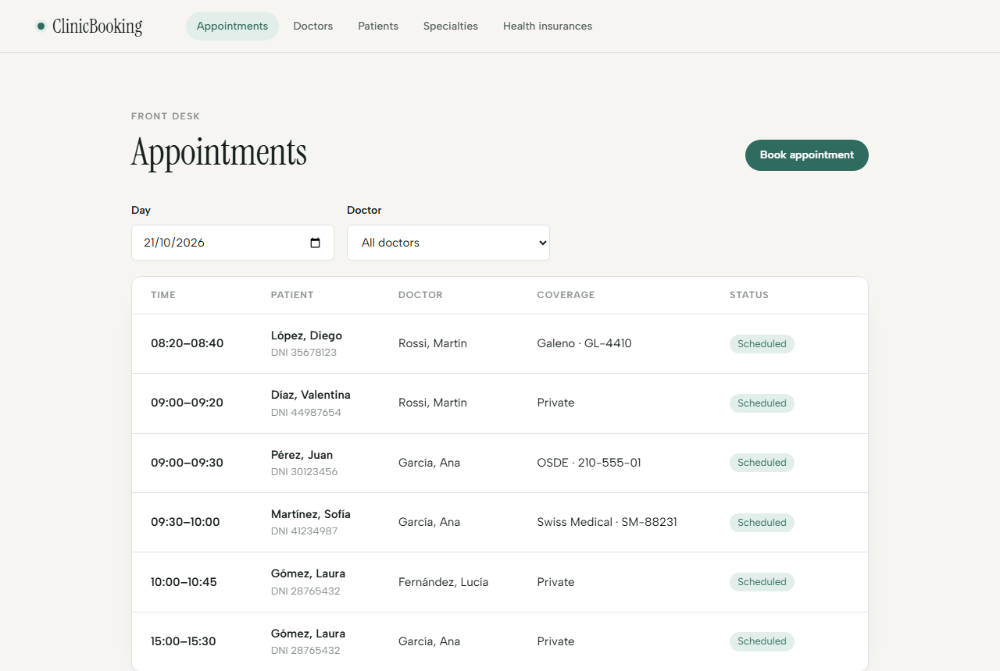
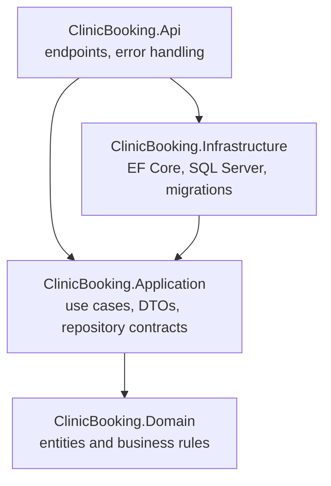
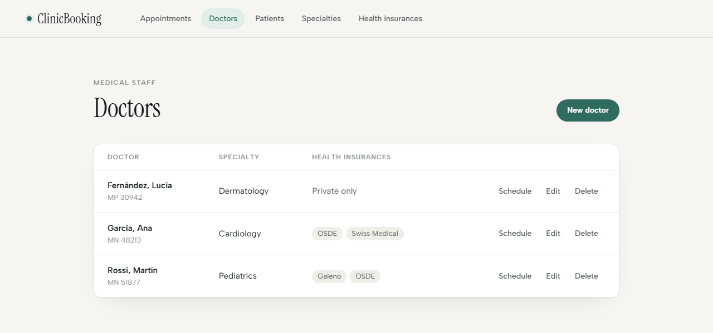
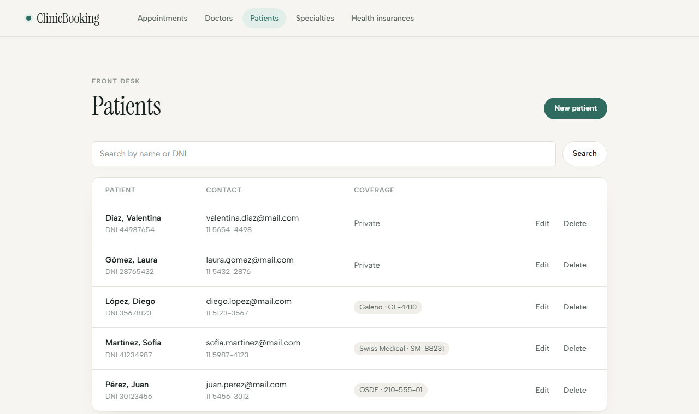
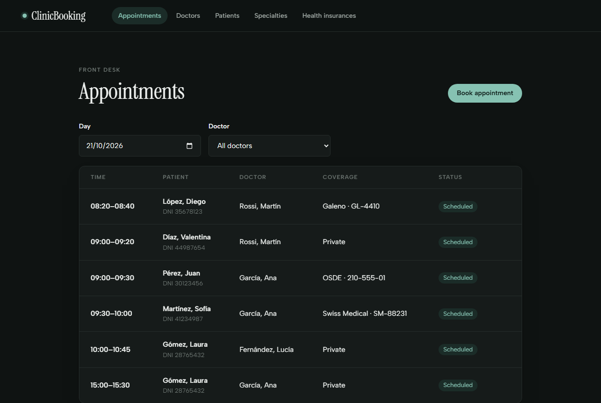

# ClinicBooking

[](https://github.com/LeonelSaabDev/clinic-booking-fullstack/actions/workflows/ci.yml)

**Medical appointment booking for a clinic, built with ASP.NET Core 10, Clean Architecture, SQL Server and Angular 22.**

The front desk manages specialties, health insurances, doctors with weekly schedules and patients, then books appointments that can never be double-booked, even when two people click on the same slot at the same time.



## Highlights

- **Double booking is impossible.** Two layers protect every slot: an application check that gives a clear message, and a filtered unique index in SQL Server as the final guard. A load test with 25 simultaneous requests per slot always produced exactly one booking and zero server errors.
- **Real scheduling rules.** Weekly working hours with split shifts, a per-doctor appointment length, and free slots computed on the fly in the clinic's time zone.
- **A full appointment lifecycle.** `Scheduled` → `Completed`, `NoShow` or `Cancelled` (with 24 hours of notice). A cancelled appointment frees its slot immediately.
- **Role-based access with JWT.** The front desk manages everything; each doctor signs in to see only their own agenda. The API takes the doctor from the signed token, never from the request.
- **Rich domain model.** Every rule lives in its entity; an invalid doctor, patient or appointment cannot exist.
- **Built test first.** 185 backend unit tests (xUnit) and 82 frontend tests (Vitest), written with TDD, plus 11 API integration tests that run against a real SQL Server in Docker.
- **One command to run it all.** Docker Compose starts SQL Server, applies the migrations, and serves the API and the web app; GitHub Actions runs every test on each push.
- **Modern Angular.** Standalone components, signals, `rxResource`, `linkedSignal`, typed reactive forms and lazy-loaded routes.
- **Argentinian context.** Health insurances (*obras sociales*) with member numbers, DNI normalization and the `America/Argentina/Buenos_Aires` time zone.

## Tech stack

| Layer | Technology |
|-------|------------|
| API | ASP.NET Core 10 (Minimal APIs), JWT bearer authentication, OpenAPI + [Scalar](https://scalar.com) |
| Persistence | Entity Framework Core 10, SQL Server |
| Frontend | Angular 22, TypeScript, plain CSS with design tokens and dark mode |
| Tests | xUnit + `FakeTimeProvider` (backend), `WebApplicationFactory` + Testcontainers (integration), Vitest + Angular TestBed (frontend) |
| Delivery | Docker multi-stage images, nginx, Docker Compose, GitHub Actions |

## Getting started

### Quick start with Docker

The only requirement is [Docker Desktop](https://www.docker.com/products/docker-desktop/).

1. **Create the secrets file.** Copy `.env.example` to `.env` and replace both values. `.env` is git-ignored.
2. **Start everything** (the first build takes a few minutes):

   ```bash
   docker compose up --build -d
   ```

3. **Create the first receptionist.** The database starts empty:

   ```bash
   docker compose run --rm api create-receptionist <email> <password>
   ```

4. Open **http://localhost:8080**.

| Container | Role |
|-----------|------|
| `db` | SQL Server 2022. Its data lives in the `sqldata` volume, so it survives restarts. Reachable from this machine on `localhost,14330`. |
| `migrate` | Runs `migrate` once to create or upgrade the schema, then exits. The API waits for it to succeed. |
| `api` | The ASP.NET Core API, not published to the host. |
| `web` | nginx serving the Angular build and forwarding `/api` to the API, so the browser sees a single origin and needs no CORS. |

`docker compose down` stops everything and keeps the data; `docker compose down -v` also deletes the database.

### Local development

#### Prerequisites

- [.NET SDK 10](https://dotnet.microsoft.com/download)
- SQL Server (LocalDB, Express or Developer edition)
- [Node.js](https://nodejs.org) 24 or later and the Angular CLI: `npm install -g @angular/cli`
- EF Core tools: `dotnet tool install --global dotnet-ef`

#### Run it

1. **Create the database.** The connection string lives in `backend/src/ClinicBooking.Api/appsettings.Development.json` and points to `localhost` with Windows authentication. Adjust it if your SQL Server instance is different, then apply the migrations:

   ```bash
   dotnet ef database update --project backend/src/ClinicBooking.Infrastructure --startup-project backend/src/ClinicBooking.Api
   ```

2. **Set the JWT signing key.** It signs every access token, so it never lives in the repository. For development, store it in [User Secrets](https://learn.microsoft.com/aspnet/core/security/app-secrets) (any long random value works):

   ```bash
   dotnet user-secrets set "Jwt:SigningKey" "<at least 32 random characters>" --project backend/src/ClinicBooking.Api
   ```

3. **Create the first receptionist.** Only a receptionist can create other accounts, so the first one comes from a command:

   ```bash
   dotnet run --project backend/src/ClinicBooking.Api -- create-receptionist <email> <password>
   ```

4. **Start the API** (from the repository root):

   ```bash
   dotnet run --project backend/src/ClinicBooking.Api --launch-profile http
   ```

5. **Start the frontend** (in a second terminal):

   ```bash
   cd frontend
   npm install
   ng serve
   ```

| What | URL |
|------|-----|
| Web app | http://localhost:4200 |
| API | http://localhost:5254/api |
| Interactive API docs (Scalar) | http://localhost:5254/scalar |

### Run the tests

```bash
dotnet test backend/ClinicBooking.slnx
```

The integration tests start a throwaway SQL Server container with [Testcontainers](https://dotnet.testcontainers.org), so Docker must be running. They host the real API in memory and cover sign-in, roles, doctor isolation, `409` on a taken slot, and 20 simultaneous bookings for the same slot (exactly one wins).

```bash
cd frontend
ng test --watch=false
```

## How double booking is prevented

This is the core problem of any booking system: two receptionists, or two patients, ask for the same slot at the same moment. Both ask "is it free?", both hear "yes", and both book.

| Layer | What it does | What it can't do |
|-------|--------------|------------------|
| **Application check** | Before booking, the service verifies that the time is one of the doctor's free slots. It answers `409` with a clear message in almost every case. | Two requests running at the same instant can both pass it. |
| **Filtered unique index** | SQL Server allows only one row per `(DoctorId, StartsAt)` **where `Status = 'Scheduled'`**. The repository translates the violation into the same `409`. | Nothing: the database is the one place where two concurrent writes cannot both win. |

The index is **filtered** on purpose. A plain unique index would also block slots whose appointment was cancelled; with the filter, cancelling frees the slot at once.

**Measured result:** 25 synchronized requests for each of 4 slots (100 in total) produced exactly 4 bookings, 96 conflicts and no `500`. In 52 of those conflicts the requests had already passed the application check, and only the database index stopped them.

**Kept honest by tests:** an integration test fires 20 bookings for the same slot at once, and another writes a duplicate straight through the repository, skipping the application check. Disabling the translation of the index violation makes exactly those two tests fail.

## Security

| Concern | How it is handled |
|---------|-------------------|
| Passwords | Hashed with ASP.NET Core Identity's PBKDF2 hasher (random salt, many iterations), behind our own interface. At least 10 characters, no symbol rules. |
| Sign-in errors | "Invalid email or password" for both an unknown email and a wrong password, so accounts can't be discovered. |
| Tokens | JWT signed with HMAC-SHA256, valid for 1 hour. The signing key lives in User Secrets (or the git-ignored `.env` with Docker), never in the repository, and the API refuses to start without it. Only `HS256` is accepted. |
| Containers | Both images run as non-root users and contain no SDK or compiler. Only the web container is published; the API sits behind nginx. |
| Authorization | Policies per role on every endpoint, plus a fallback policy: an endpoint someone forgets to protect still requires a signed-in user. |
| Doctors' data | A doctor's id comes from the signed token. Asking for another doctor's agenda returns your own; another doctor's appointment answers `404`, so ids can't be probed. |
| Frontend | Route guards and a role-aware menu shape the experience; the API remains the real protection. The token is attached only to calls to our own API, and a `401` signs the user out. |

**Known trade-off:** the frontend keeps the token in `sessionStorage`, so it is lost when the tab closes. A script injected through an XSS flaw could read it; Angular escapes rendered content by default and the token expires in an hour, which is a reasonable balance for this project. An `HttpOnly` cookie would be safer, at the cost of CSRF protection and more moving parts.

## Architecture

The backend follows Clean Architecture. Each layer has a single responsibility, and **dependencies always point inward**: the domain knows nothing about HTTP, EF Core or SQL Server.



| Layer | Responsibility |
|-------|----------------|
| **Domain** | `Specialty`, `HealthInsurance`, `Doctor` (with its weekly schedule and accepted health insurances), `Patient` and `Appointment` (with its lifecycle). Entities are created through factory methods that validate every rule. |
| **Application** | Use cases, DTOs and repository contracts. Rules that need other records live here: unique names, free slots, patient overlaps. |
| **Infrastructure** | EF Core repositories, table configuration, the filtered unique index and migrations. |
| **Api** | Minimal API endpoints, the exception handler that maps errors to Problem Details, and the composition root. |

The frontend is organized by feature (`appointments`, `doctors`, `patients`, `specialties`, `health-insurances`), each split into:

| Folder | Role |
|--------|------|
| `data-access/` | Models, pure mapping functions and the HTTP client. |
| `pages/` | Containers: load data, handle navigation and talk to the API. |
| `components/` | Presentational: receive data through inputs and emit events. They know nothing about HTTP or routes. |

### Business rules

| Area | Rule |
|------|------|
| Doctor | Unique license number; one specialty; any number of accepted health insurances |
| Schedule | Blocks per weekday in clinic local time; blocks on the same day cannot overlap; appointment length between 10 and 120 minutes, in steps of 5 |
| Patient | Unique DNI, accepted with or without dots; valid email; member number required when the patient has a health insurance |
| Booking | Only free slots of the doctor's schedule; a patient cannot have two overlapping appointments; health insurance only if the doctor accepts it |
| Lifecycle | Cancel at least 24 hours in advance; complete or mark as no-show only once the appointment has started; no transition out of a closed appointment |
| Deleting | Specialties, health insurances, doctors and patients in use cannot be deleted |

## Key decisions

| Decision | Why |
|----------|-----|
| Filtered unique index as the final guard | The only reliable protection against concurrent bookings, and it keeps cancelled slots bookable. |
| Free slots computed, not stored | Changing a schedule never leaves stale slots behind. |
| Schedules in local time, appointments in UTC | "Mondays at 9" is a clinic rule; an appointment is an instant. Responses carry the clinic's offset, e.g. `2026-10-21T09:00:00-03:00`. |
| `TimeProvider` instead of `DateTime.Now` | Rules such as "24 hours in advance" or "already started" are tested with a frozen clock. |
| Coverage snapshot on each appointment | If a patient changes health insurance, past appointments still show what was used. |
| Aggregates reference each other by id | A doctor stores `SpecialtyId`, not a `Specialty`; each entity keeps its own rules, and foreign keys guarantee integrity. |
| State transitions as commands | `POST /appointments/{id}/cancel` instead of a free `PATCH status`, so each transition enforces its own rules. |
| `400` vs `409` | A time that is not a slot is an invalid request; a slot that is already taken is a conflict. The frontend reacts differently to each. |
| Hand-written fakes instead of mocks | Tests check outcomes, not which methods were called, so refactoring the services doesn't break them. |
| Clinic time shown from the API string | The frontend never converts instants with `Date` for display, so times look the same from any time zone. |
| Integration tests on a real SQL Server | The filtered index and its error translation can't be proven with fakes or an in-memory provider. |
| Migrations as a separate one-off step | Running them at API startup would make several instances race to migrate; a dedicated `migrate` command runs once before the API. |

## API

| Method | Route | Description |
|--------|-------|-------------|
| `POST` | `/api/auth/login` | Sign in and receive a JWT (the only public endpoint) |
| `GET` `POST` | `/api/users` | User accounts (receptionists only) |
| `GET` | `/api/appointments?date={yyyy-MM-dd}&doctorId={id}` | Appointments of a clinic day, optionally for one doctor |
| `POST` | `/api/appointments` | Book an appointment (`409` if the slot is taken) |
| `POST` | `/api/appointments/{id}/cancel` | Cancel (at least 24 hours in advance) |
| `POST` | `/api/appointments/{id}/complete` | Mark as completed |
| `POST` | `/api/appointments/{id}/no-show` | Mark as no-show |
| `GET` | `/api/doctors/{id}/availability?date={yyyy-MM-dd}` | Free slots of a doctor on a day |
| `GET` `PUT` | `/api/doctors/{id}/schedule` | Weekly working hours and appointment length |
| `GET` `POST` `PUT` `DELETE` | `/api/doctors` | Doctors |
| `GET` `POST` `PUT` `DELETE` | `/api/patients?search={term}` | Patients, searchable by name or DNI |
| `GET` `POST` `PUT` `DELETE` | `/api/specialties` | Specialties |
| `GET` `POST` `PUT` `DELETE` | `/api/health-insurances` | Health insurances |

Every endpoint except login needs `Authorization: Bearer <token>`. Reading is open to all staff; creating, editing and deleting are for receptionists. Doctors can only list and close their own appointments.

Errors use the [Problem Details](https://www.rfc-editor.org/rfc/rfc9457) format, and the frontend shows the domain's own message:

```json
{
  "title": "Conflict",
  "status": 409,
  "detail": "That slot was just booked by someone else. Please choose another one."
}
```

## Project structure

```text
.
├── .github/workflows/ci.yml               # Tests and image builds on every push
├── docker-compose.yml                     # db, migrate, api and web
├── .env.example                           # Template for the git-ignored .env
├── backend/
│   ├── Dockerfile
│   ├── ClinicBooking.slnx
│   ├── src/
│   │   ├── ClinicBooking.Domain/          # Entities and business rules
│   │   ├── ClinicBooking.Application/     # Use cases, DTOs, repository contracts
│   │   ├── ClinicBooking.Infrastructure/  # EF Core, configurations, migrations
│   │   └── ClinicBooking.Api/             # Endpoints, error handling, composition root
│   └── tests/
│       ├── ClinicBooking.Domain.Tests/
│       ├── ClinicBooking.Application.Tests/
│       └── ClinicBooking.Api.IntegrationTests/  # Real API + SQL Server in Docker
├── frontend/
│   ├── Dockerfile
│   ├── nginx.conf                         # Serves the app and proxies /api
│   └── src/app/
│       ├── core/auth/                     # Session, interceptor and route guards
│       ├── features/                      # appointments, auth, doctors, patients, specialties, health-insurances, users
│       └── shared/                        # Clinic time helpers
└── docs/screenshots/
```

## Screenshots

| Doctors | Patients |
|---------|----------|
|  |  |

| Dark mode |
|-----------|
|  |

## Roadmap

- [x] Authentication and roles (JWT): front desk and doctors see different things
- [x] API integration tests against a real SQL Server (Testcontainers)
- [x] Docker Compose setup to run everything with one command
- [x] CI pipeline with GitHub Actions
- [ ] Refresh tokens, so sessions can outlive the one-hour access token
- [ ] A patient portal to book appointments online
